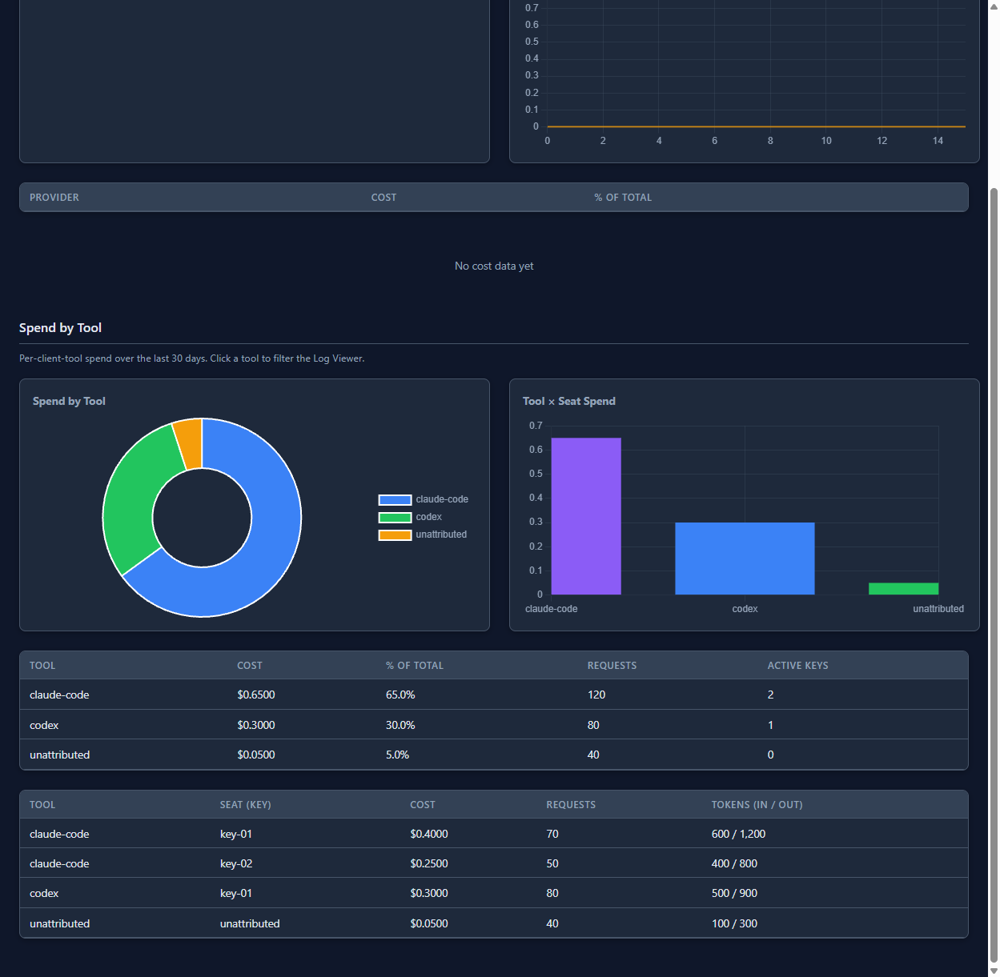

# Coding Tool Spend Views

When several coding agents hit the same gateway — Claude Code from one seat, Codex from another, Cursor from a third — the cost ledger records every request, but the spend dashboard showed a flat total. You could break it down by provider, model, or virtual key, but not by the tool that actually sent the request. Coding Tool Spend Views add that breakdown with zero configuration: every request is attributed to its coding tool from the User-Agent header at ingest time, and that attribution flows into cost reports, the admin log search, and the dashboard's Cost Breakdown section.

The feature adds no routes or configuration keys. It reuses the billing-grade cost-reporting pipeline and the existing virtual-key seat model, so the same reconciliation guarantees (restart-proof reads, `#attempt` exclusion, `unattributed` bucket honesty) carry over to the tool dimension.

---

## How Attribution Works

Each front door (`/v1/chat/completions`, `/v1/responses`, `/v1/messages`) reads the incoming `User-Agent` header once and passes it through a case-insensitive, token-boundary-anchored matcher before the request is dispatched. The match produces one canonical token from a closed vocabulary; that token is persisted on the request ledger row and inherited by every `#attempt` and 499/504 outcome row for that request. Attribution is client-identity data, so it stays constant across retries and failover attempts. If the header is missing, empty, malformed, or doesn't match a known signature, the row reads `unattributed` and the request proceeds normally.

### Tool Vocabulary

| Canonical token | User-Agent signatures matched (case-insensitive, token-start anchored) |
|------------------|---------------------------------------------------------------------------|
| `claude-code`    | `claude-cli`, `claude-code`                                               |
| `codex`          | `codex/`, `codex_cli`, `codex-http`                                       |
| `cursor`         | `cursor/`, `cursor-`                                                      |
| `gemini-cli`     | `gemini-cli`, `google-gemini`                                             |
| `qwen-code`      | `qwen-code`, `qwen_cli`                                                   |
| `roo-code`       | `roo-code`, `roo_cline`                                                   |
| `opencode`       | `opencode`                                                                |
| `unattributed`   | (no match, missing, empty, or non-UTF8 header)                           |

"Token-start" means the signature must begin at a token boundary: the start of the UA string, or immediately after a space, `/`, `(`, `-`, or `_`. This prevents false positives like `my-cursor-tool/1.0`, whose token starts at `my-`. Only the canonical token is stored, never the raw User-Agent string, so the ledger stays compact and the fingerprinting surface small.

### Legacy Databases

The `client_tool` column is additive (`ensure_column`, nullable TEXT). Databases created before the column existed read every row as `unattributed` with zero-default semantics, identical to how the virtual-key dimension handles missing `key_id` data. No migration step, backfill, or rewrite is needed.

---

## Cost Report Groupings

Two new `group_by` values extend the cost-reports endpoint:

```text
GET /admin/cost-reports?start=<RFC3339>&end=<RFC3339>&group_by=client_tool&client_tool=<token>&format=<csv|json>
```

### `group_by=client_tool`

One row per distinct coding tool (including `unattributed`) with the same aggregate columns as existing groupings: `requests`, `input_tokens`, `output_tokens`, `cache_read_tokens`, `cache_creation_tokens`, `reasoning_tokens`, `cost_usd` (6 decimals), `cost_unpriced_requests`, `window_start`, `window_end`. Rows order by cost descending, ties broken by dimension ascending. `#attempt` marker rows are excluded, same as every other grouping.

Each row also carries `active_keys`: the count of distinct non-`unattributed` virtual keys attributed to that tool in the range. A tool row whose traffic is all `unattributed` (no virtual keys) reports `0`. This field is emitted only for `client_tool` and `client_tool_key` groupings; all pre-existing groupings keep their exact previous JSON and CSV shape.

### `group_by=client_tool_key`

One row per (tool, virtual-key) pair, with the dimension formatted as `<tool>:<key_id>`. Rows with no key attribution read `<tool>:unattributed`. The same aggregate columns apply; `active_keys` is not surfaced on this grouping (the pair count already conveys seat breadth). A `key_id` filter restricts the report to one seat's tools; a `client_tool` filter restricts it to one tool's seats. Both compose conjunctively with each other and with the existing `provider` filter.

### Filter

The `client_tool` query parameter filters any grouping to a single tool token. It normalizes the same way as `provider` and `key_id`: empty or whitespace-only becomes no filter, and `unattributed` matches rows with NULL/empty attribution (including all legacy rows). An unknown value is not an error — it returns an empty report.

### Reconciliation

The sum of `cost_usd` across all `client_tool` rows equals the sum across all `day` rows over the same range (within 2-decimal rounding tolerance). No row is dropped or double-counted; the tool dimension sums to total spend exactly as the provider and virtual-key dimensions do.

### CSV

`format=csv` adds a trailing `active_keys` column for `client_tool` and `client_tool_key` reports. Other groupings keep the original CSV header and rows byte-for-byte.

---

## Usage Examples

Spend per coding tool over the last 7 days:

```bash
curl -u admin:admin \
  "http://localhost:8080/admin/cost-reports?start=2026-11-19T00:00:00Z&end=2026-11-26T00:00:00Z&group_by=client_tool"
```

```json
{
  "rows": [
    {
      "dimension": "claude-code",
      "window_start": 1732492800,
      "window_end": 1733097600,
      "requests": 184,
      "input_tokens": 412000,
      "output_tokens": 96500,
      "cache_read_tokens": 21000,
      "cache_creation_tokens": 4800,
      "reasoning_tokens": 31000,
      "cost_usd": 1.842050,
      "cost_unpriced_requests": 0,
      "active_keys": 4
    },
    {
      "dimension": "codex",
      "window_start": 1732492800,
      "window_end": 1733097600,
      "requests": 96,
      "input_tokens": 188000,
      "output_tokens": 44200,
      "cache_read_tokens": 0,
      "cache_creation_tokens": 0,
      "reasoning_tokens": 0,
      "cost_usd": 0.714100,
      "cost_unpriced_requests": 0,
      "active_keys": 3
    }
  ],
  "totals": {
    "dimension": "total",
    "window_start": 1732492800,
    "window_end": 1733097600,
    "requests": 280,
    "input_tokens": 600000,
    "output_tokens": 140700,
    "cache_read_tokens": 21000,
    "cache_creation_tokens": 4800,
    "reasoning_tokens": 31000,
    "cost_usd": 2.556150,
    "cost_unpriced_requests": 0
  }
}
```

Filter to a single tool:

```bash
curl -u admin:admin \
  "http://localhost:8080/admin/cost-reports?start=2026-11-19T00:00:00Z&end=2026-11-26T00:00:00Z&group_by=client_tool&client_tool=claude-code"
```

Tool × seat breakdown for one tool:

```bash
curl -u admin:admin \
  "http://localhost:8080/admin/cost-reports?start=2026-11-19T00:00:00Z&end=2026-11-26T00:00:00Z&group_by=client_tool_key&client_tool=codex&format=csv"
```

---

## Dashboard

The Cost Breakdown section of the embedded dashboard adds a **Spend by Tool** view. It fetches `group_by=client_tool` and `group_by=client_tool_key` on the section's existing refresh cadence and renders:

- A doughnut chart of spend per tool
- A bar chart of spend per tool × seat
- A ranked tool table with Cost, % of Total, Requests, and Active Keys columns
- A tool × seat table with Tool, Seat (Key), Cost, Requests, and Tokens (In / Out)

Clicking a tool row or chart segment drills into the Log Viewer with the Coding Tool filter set to that tool — the same drill-down path the provider view uses.

When no attributed traffic exists in range, the view shows an explicit empty state naming the `unattributed` dimension rather than a blank chart. If the fetch fails, the view degrades to an in-place error note and leaves the existing cost views untouched.



---

## Admin Log Filter

The admin panel's Log Search form adds a **Coding Tool** select with the full vocabulary plus `unattributed`. It binds to the request-log query's `client_tool` parameter (exact match against the ledger column). Legacy rows display `unattributed` in the tool column; a missing column degrades the same way — the filter matches only `unattributed` rows, never an error.

The dashboard's Log Viewer includes the same Coding Tool filter (`f-tool`) and renders a per-row tool badge so you can see at a glance which tool produced each request.

---

## Zero Configuration

The feature ships default-on with no YAML keys or admin toggles. Attribution runs on the request path with no awaits and no I/O; classification is a pure function over headers already available to every handler. Tool names in UI are the stable canonical tokens (`claude-code`, `codex`, ...); `unattributed` is displayed as-is, consistent with the virtual-key dimension.