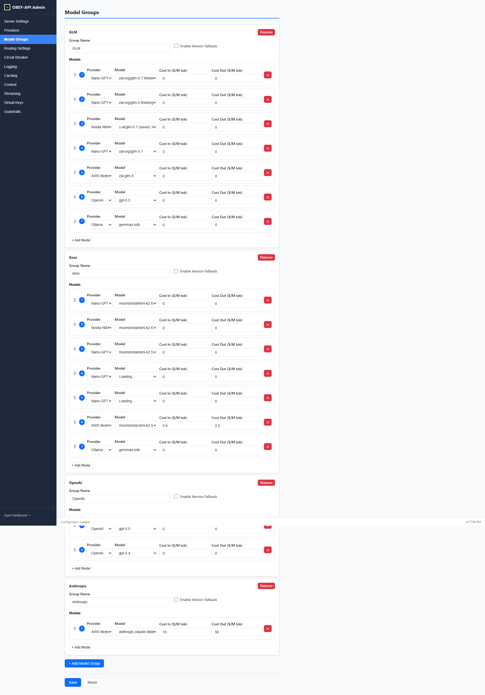
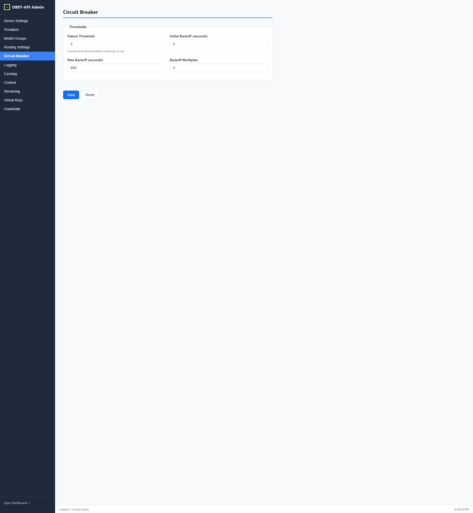
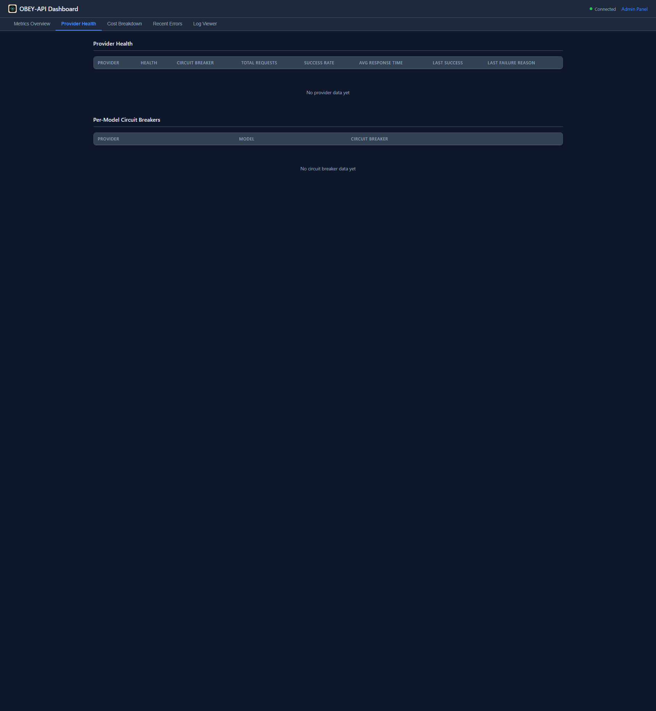

# Routing & Failover

OBEY API Gateway's core strength is intelligent request routing with automatic failover. When a provider fails, the gateway transparently tries the next one — your application never notices.

---

## How Routing Works

1. **Client sends a request** with a model name (e.g., `gpt-4-group`)
2. **Gateway resolves the model group** matching that name
3. **Models within the group are sorted** by priority (lower = higher priority)
4. **Router checks each candidate** in order:
   - Is the circuit breaker closed (healthy)?
   - Is the provider within its rate limit?
   - What's the current latency?
5. **Request is forwarded** to the first eligible provider
6. **On failure**, the next provider in the fallback chain is tried

```
Client Request → Model Group Resolution → Priority Sorting
                                              │
                    ┌─────────────────────────┼────────────────────────┐
                    ▼                         ▼                        ▼
              Provider A               Provider B                Provider C
            (priority: 1)            (priority: 2)             (priority: 3)
              ┌─────┐                  ┌─────┐                  ┌─────┐
              │ CB  │                  │ CB  │                  │ CB  │
              │Check│                  │Check│                  │Check│
              └──┬──┘                  └──┬──┘                  └──┬──┘
                 │                        │                        │
              [Success] ──────────────────────────────────────▶ Response
                 │
              [Failure] ──▶ Try Provider B ──▶ Try Provider C ──▶ Error
```

---

## Model Groups

Model groups define equivalent models that can serve the same requests:

```yaml
model_groups:
  - name: "gpt-4-group"
    version_fallback_enabled: false
    models:
      - provider: "openai"
        model: "gpt-4"
        cost_per_million_input_tokens: 10.0
        cost_per_million_output_tokens: 30.0
        priority: 1                   # Highest priority (tried first)

      - provider: "ollama-local"
        model: "llama3"
        priority: 2                   # Fallback

      - provider: "together"
        model: "meta-llama/Meta-Llama-3-70B"
        priority: 3                   # Last resort
```

Clients reference the group name as the model:
```python
client.chat.completions.create(model="gpt-4-group", ...)
```

### Model Groups in the Admin UI



### Version Fallback

When `version_fallback_enabled: true`, the gateway sorts the whole group by version date (newest first) — the newest dated model is preferred even over lower-priority or cheaper models, undated models keep their normal priority/cost/latency order after all dated ones, and failover walks older versions before undated fallbacks. Useful for models that frequently update.

---

## Circuit Breakers

Each provider has an independent circuit breaker that prevents repeated calls to failing providers.

```yaml
circuit_breaker:
  failure_threshold: 3              # Consecutive failures to trip
  backoff_sequence_seconds: [5, 10, 20, 40, 300]
  success_threshold: 1              # Successes to recover
```



### States

| State | Behavior |
|-------|----------|
| **Closed** | Normal operation — requests flow through |
| **Open** | Provider is marked unhealthy — requests skip immediately |
| **Half-Open** | After backoff period — one test request allowed |

### Backoff Sequence

After tripping, the circuit breaker waits progressively longer between recovery attempts:

```
Trip → 5s wait → test → fail → 10s wait → test → fail → 20s wait → ...
```

The sequence resets on successful recovery.

### Reset on Config Reload

All circuit breakers are cleared when configuration is reloaded via the admin API. This lets you manually recover a provider after fixing the underlying issue.

---

## Smart Rate-Limit Failover

The gateway detects rate limiting across multiple signal types and instantly fails over:

| Signal | Detection |
|--------|-----------|
| HTTP 429 | Standard rate limit response |
| Rate-limit-shaped 200 | Response body contains rate limit error despite 200 status |
| `Retry-After` header | Honored for cooldown duration |
| `X-RateLimit-Reset` header | Used to calculate cooldown |
| Anthropic ISO reset headers | Parsed for exact reset time |
| Weekly-quota providers | Per-provider cooldown overrides for providers like Nano-GPT |

When rate-limited, the provider is temporarily skipped (not circuit-broken — rate-limit failures do not count toward the circuit-breaker threshold) and requests route to the next provider immediately. The cooldown also applies to streaming pass-through attempts, which consume the provider's `rate_limit_per_minute` tokens just like non-streaming requests.

---

## Retry Policy

Failed requests are retried within a provider before failing over to the next:

```yaml
retry:
  max_retries_per_provider: 1       # Retries per provider
  backoff_sequence_seconds: [1, 2, 4]
  upstream_retry_after_max_wait_ms: 0 # Bounded primary 429 wait (0 = off, max 60000, 15000 recommended)
```

Retries use the backoff sequence below and trigger only for the error classes marked "retry" in the classification table above. All other classes fail over immediately.

### Retry Classification (Unified)

Both the buffered dispatch stack and the streaming pass-through stack now use one policy table, so behavior is identical in either mode:

| Error class | Behavior |
|-------------|----------|
| Timeout-class (TTFB, total, chunk timeout; upstream 504/524) | Fail over immediately — no same-provider retry (unchanged, per ADR 0001) |
| 429, 503, other 4xx | Fail over immediately — no same-provider retry |
| 500/501/502/5xx, 408, network/body-read errors | Retry the same provider, up to `max_retries_per_provider` |

### Jittered Backoff

Retry backoff delay is uniformly randomized within ±`jitter_ratio` of the `backoff_sequence_seconds` value, using a real RNG. With jitter disabled (ratio 0), the exact sequence values apply (1, 2, 4 by default — unchanged).

### Retry Budget (Zero-Config)

Concurrent same-provider retries per provider are capped at max(3, 20% of active requests). When the budget is exhausted, the gateway fails over immediately and records a `retry_budget_exhausted` attempt row. First attempts are never delayed.

### Deadline Cap

Retries whose backoff would exceed the request's effective deadline are not scheduled — the request fails over (or returns) instead of overshooting the deadline.

### Bounded Primary 429 Wait

`retry.upstream_retry_after_max_wait_ms` (u64; 0 = off = current behavior; valid 0–60000; 15000 recommended) enables a bounded wait for the **primary** provider when it returns 429 with a parseable Retry-After hint:

- The gateway waits the full Retry-After only while it stays within `upstream_retry_after_max_wait_ms` — once per request, holding no admission permit and raced against the request deadline — then retries the primary through normal admission. An over-cap Retry-After is not clamped: no wait, cooldown + failover.
- Non-primary 429s, waits over budget, a second 429, or a hint of 0 keep the existing behavior: cooldown + failover.
- Also configurable as a numeric control in the Admin UI's Retry Configuration fieldset (same range and help text).

### Attempt Count Header

Every response — buffered or streaming, success or failure — carries `x-obey-attempt-count`: the total attempt rows recorded in the request ledger for that request, counting upstream sends plus recorded skips (`circuit_open_skip`, `rate_limit_skip`, `retry_budget_exhausted`, `rate_limit_wait`). A request that never fails over reports 1; an exact- or semantic-cache hit reports 0, since no upstream dispatch occurs. On streaming responses whose headers commit before dispatch completes, the value is the best-known count at header time.

### Sticky Cache Re-Pin on Failover

When failover moves a request to a different provider, a sticky prompt-cache entry is re-pinned to the successful provider (prefix hash and TTL preserved). Each re-pin emits a debug log and increments the `obey_api_sticky_repins_total` metric (visible in `/metrics` when Prometheus is enabled).

---

## Priority & Cost-Aware Routing

Models within a group are sorted by `priority` (lower = higher priority). For equal-priority models, the gateway considers:

- **Cost** — `cost_per_million_input_tokens` and `cost_per_million_output_tokens` for budget-aware selection
- **Latency** — tracked per-provider for optimal response times
- **Provider health** — circuit breaker and rate limit status

```yaml
models:
  - provider: "openai"
    model: "gpt-4"
    cost_per_million_input_tokens: 10.0
    cost_per_million_output_tokens: 30.0
    priority: 1      # Primary

  - provider: "together"
    model: "meta-llama/Meta-Llama-3-70B"
    cost_per_million_input_tokens: 0.9
    cost_per_million_output_tokens: 0.9
    priority: 2      # Cheaper fallback
```

### Smart Routing Tier Overflow

When Smart Routing selects a tier, the models in that tier are tried first. If they are all unavailable (circuit open, cooldown) or fail, the rest of the group's context-safe models (untiered, other tiers, non-specialists) are tried next, in the same priority/cost/latency order. Models whose context window is too small for the request are never added. Pinned requests are unaffected.

### Smart Routing Decision Log

Each request with a (non-bypassed) Smart Routing decision logs one content-free INFO line, at most once per request even when a streaming request fails over and is re-planned, so `journalctl -u obey-api-gateway -f` shows why a tier was chosen:

```
INFO Smart routing decision trace_id=... group=coding tier=balanced score=0.412 classifier_configured=jev classifier_used=heuristic task_type=code_generation blended=false fallback_reason=low_confidence candidates=2 overflow=3 context_filtered=false escalated=false classifier_latency_ms=184.0
```

`fallback_reason` appears when the configured classifier fell back to the heuristic:

- `low_confidence`
- `timeout`
- `backend`: System One still returned a retryable status (such as 429 or 503) after retries, or returned 401/403 or 413
- `invalid_output`: System One returned 422, or the score was outside 0–1
- `unavailable`: no classifier is attached, the call hit a transport error or another HTTP status, or the response could not be read
- `no_jev_at_endpoint`

With `fallback_policy: blend`, a low-confidence System One score is mixed with the heuristic instead: `classifier_used=jev blended=true confidence=...`. With `fallback_policy: fallback`, the confidence that missed the threshold is logged at DEBUG (`System One low confidence; using heuristic`).

Failures other than low confidence also log a WARN (`Smart routing classifier failed`) at most once per 60 s per classifier and reason. When a System One call returns an error, a second rate-limited WARN (`System One classifier call failed`) adds the error class and HTTP status. If the classifier's own timeout expires first, only the first WARN is logged.

Pinned and bypassed requests log no decision line. A buffered request logs its line after it succeeds, so a request that fails on every provider logs none, the same as the decision metric. A streaming request logs its line when the upstream stream is set up, and the line stays even if the stream fails later.

---

## Context Window Management

When a request exceeds a model's context window limit, the gateway automatically truncates messages to fit rather than failing with a context-length error. This ensures requests always have a chance of succeeding even with large conversation histories.

---

## Latency Tracking

The gateway maintains rolling latency statistics per provider. This data is:
- Used for routing decisions between equal-priority providers
- Displayed in the dashboard metrics
- Available via the Prometheus endpoint

### Provider Health in the Dashboard



---

## Error Aggregation

When all providers in a model group fail, the gateway returns an aggregated error showing each attempt:

```json
{
  "error": {
    "message": "All providers failed",
    "type": "gateway_error",
    "attempts": [
      {"provider": "openai", "error": "timeout after 30s"},
      {"provider": "ollama", "error": "connection refused"},
      {"provider": "together", "error": "rate limited (retry after 60s)"}
    ]
  }
}
```

---

## Next Steps

- [Streaming](Streaming) — how streaming works with failover
- [Providers](Providers) — configure your providers
- [Configuration](Configuration) — full config reference
