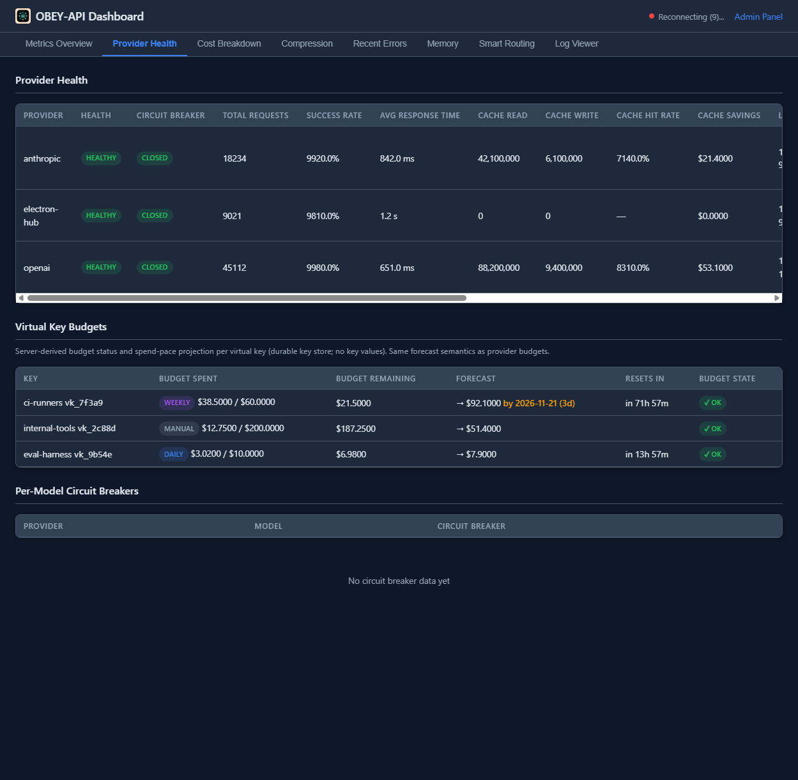

# Spend Pace Forecasting

Budget alerts tell you what already happened. Spend pace forecasting tells you where spend is heading: for every provider and virtual-key budget with a USD limit, the gateway computes a projected end-of-window spend, a projected exhaustion date when the pace outruns the limit, and — the first time a window's projection shows exhaustion inside the window — a `budget.forecast.warning` webhook, before actual spend crosses anything. The projection also appears next to current spend in the dashboard with zero configuration.

The feature is default-on for every budgeted scope, introduces no new configuration keys, and computes from durable state only (the provider budget store, the virtual-key usage store, and the request ledger). Nothing is derived from in-memory metrics, so restarting the gateway yields identical projections.

---

## Projection Methods

Each budget has a configured USD limit and a reset policy. The policy picks the method:

### Window pace (daily, weekly, monthly)

Window-to-date spend is extrapolated to the window's **configured end** — the same boundary the rollover check computes — never to a fixed calendar-month end regardless of the reset window:

```
pace      = spent_usd / elapsed_seconds
projected = spent_usd + pace × remaining_seconds
```

The exhaustion date is the moment the projection reaches the limit: `now + (limit − spent) / pace`. If that moment falls inside the window, the forecast reports it; if it falls at or after the window end, the budget is on pace.

### Trailing run rate (manual windows)

A manual window has no reset to extrapolate to, so the projection uses a trailing 30-day run rate derived from the request ledger (`logs.db`, `#attempt` rows excluded) and projects over a fixed 30-day horizon:

```
pace      = trailing 30-day spend / 30
projected = spent_usd + pace × 30
horizon   = now + 30 days
```

Exhaustion inside the 30-day horizon is reported the same way as exhaustion inside a windowed budget's window.

Every projection carries its method (`window_pace` or `trailing_run_rate`) in the dashboard payload and the alert event, so numbers are never a black box.

---

## Status Meanings

| Status | Meaning |
|--------|---------|
| `insufficient_data` | Not enough elapsed window time (or trailing history) to project honestly; the reported spend figure is current spend, never an extrapolation |
| `within_window` | The projection stays under the limit through the window end (or the 30-day horizon for manual scopes) — on pace |
| `exhausts_within_window` | The projection reaches the limit before the window end (or horizon end); reported with the projected exhaustion date (ISO-8601 UTC) and whole days remaining |
| `already_exhausted` | Current spend already meets or exceeds the limit; no future date is computed |

Two boundary details: exhaustion landing exactly at the window end counts as `within_window` (the budget survives its window), and `already_exhausted` takes precedence over the insufficient-data gate — a budget that blew through its limit in the first minutes of a young window is reported as exhausted, not as "not enough data."

---

## Not-Enough-Data Rules

A projection from too little history is worse than none (extrapolating hour one of a monthly window produces the day-one-blowup class of misleading numbers), so the forecast refuses to extrapolate instead:

- **Windowed scopes:** the window must be at least **5% elapsed** before window pace is trusted.
- **Manual scopes:** the ledger must cover at least **7 days of history** inside the trailing 30-day horizon. History counts distinct UTC days with recorded traffic — a single request three weeks ago followed by silence is one day of history, not twenty-one.

In both cases the status is `insufficient_data`, the dashboard shows "not enough data yet", and no forecast event fires.

---

## Forecast Alert Event

The `budget.forecast.warning` event flows through the existing unified webhook system (Standard Webhooks signing, retries, delivery ledger, dashboard alert feed). It fires when a scope's projection first shows `exhausts_within_window` — for manual scopes, exhaustion within the 30-day horizon.

Semantics, matching the shipped threshold events:

- **Default-on:** with no `events` filter configured, the event is part of the delivered set. It is individually filterable through the existing webhook event-filter configuration — no new keys; toggling it applies via config hot-reload without a restart.
- **Once per budget window:** after the event fires for a scope, it does not fire again in the same window.
- **Lazy re-arm:** the event re-arms only when the budget window rolls over or an admin resets spend. Manual windows have no rollover, so they re-arm only via admin reset.
- **Restart-safe:** fired state is re-derived at startup. Exhausted is always re-derived true, and windowed scopes seed the forecast flag only when the restart-time projection still shows `exhausts_within_window` — so a pace that fired earlier and then decayed below the limit can re-announce once after a restart (at most one duplicate), while a still-over-limit projection never re-announces.
- **Quiet states:** no event for `insufficient_data`, `within_window`, `already_exhausted`, or scopes without a configured limit. A single spend jump that crosses the warn threshold, the forecast, and the limit at once emits `budget.warning`, `budget.forecast.warning`, and `budget.exhausted` in that order.

Evaluation runs only in tasks spawned off the request path, piggybacked on the existing budget accrual paths — no background timers, no synchronous work in request handling. A transient failure (for example a busy ledger read for a manual-window run rate) silently skips that evaluation cycle; it never blocks accrual, alerting, or traffic.

### Payload

Envelope fields are the standard budget alert envelope; the projection rides in `data.forecast`:

| `data.forecast` field | Meaning |
|------------------------|---------|
| `scope` | `"provider"` or `"virtual_key"` |
| `name` | Provider name or virtual-key name |
| `key_id` | Virtual-key id (providers: absent) — never the key value |
| `spent_usd` | Current-window USD spend at evaluation time |
| `limit_usd` | Configured USD limit at evaluation time |
| `projected_usd` | Projected end-of-window (or 30-day-horizon) spend |
| `method` | `window_pace` or `trailing_run_rate` |
| `window_end` | UTC epoch seconds of the window end (windowed scopes only) |
| `horizon_end` | UTC epoch seconds of the 30-day pace-horizon end (manual scopes only) |
| `projected_exhaustion_date` | Projected UTC date the limit is reached (ISO-8601) |
| `threshold_kind` | Always `"forecast"` |

Exactly one of `window_end` / `horizon_end` is present, matching the method. Example payload:

```json
{
  "id": "00000000-0000-4000-8000-000000000004",
  "type": "budget.forecast.warning",
  "created_at": "2025-01-01T00:00:00Z",
  "signed": false,
  "data": {
    "scope": "virtual_key",
    "name": "ci-runner",
    "key_id": "key_123",
    "limit_usd": 100.0,
    "spent_usd": 40.0,
    "window": "manual",
    "window_start": 0,
    "forecast": {
      "scope": "virtual_key",
      "name": "ci-runner",
      "key_id": "key_123",
      "spent_usd": 40.0,
      "limit_usd": 100.0,
      "projected_usd": 160.0,
      "method": "trailing_run_rate",
      "horizon_end": 1761913600,
      "projected_exhaustion_date": "2025-11-27",
      "threshold_kind": "forecast"
    }
  }
}
```

---

## Dashboard

The dashboard renders the projection next to current spend on both budget surfaces — the provider table's **Forecast** column and the **Virtual Key Budgets** table — with identical semantics:



- Projected spend shown as `→ $X`, server-derived in the status payload (the page renders, never computes).
- `exhausts_within_window` additionally shows the projected exhaustion date and days remaining, highlighted (e.g. `by 2025-11-27 (5d)`).
- `insufficient_data` renders an explicit "not enough data yet" state instead of a misleading number.
- Scopes without a limit show `—`.

Hovering a forecast cell shows a tooltip documenting the method and formula in plain language, including the not-enough-data rule for that method.

---

## Implementation Notes

- Projections read `budgets.db` (provider spend and window state), `keys.db` (virtual-key usage), and `logs.db` (trailing run-rate aggregates) — all durable, all existing surfaces behind existing auth.
- For manual-window virtual-key run rates, the request logger adds a guarded `requests(key_id, timestamp)` index (created `IF NOT EXISTS`, additive and idempotent) so the trailing-sum query is an index seek rather than a full range scan of the horizon. The index's per-row cost is confined to writes on a nullable column that is `NULL` for unauthenticated traffic.
