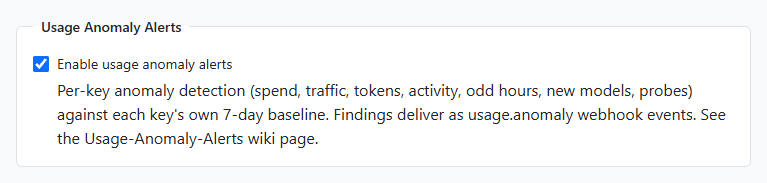

# Usage Anomaly Alerts

Usage anomaly alerts complement fleet-level performance alerts by comparing each [virtual key](Virtual-Keys) with its own usage in the requests ledger. A sudden spike or a change in when and how a key is used can indicate a compromised credential. Alerts are detection-only. Containment stays with key revocation and budgets.

## Configuration

```yaml
usage_anomaly_alerts:
  enabled: true
```

`enabled` is the only setting. It is a boolean and defaults to `true` if you omit the section. Changes apply on config hot reload. Setting it to `false` stops future evaluations. Setting it back to `true` resumes evaluation on the next tick.

## Baseline and signals

Each evaluated UTC day is compared with the preceding 7 days for that key. This rolling daily baseline uses 8 days of ledger history, including the day under review. Ratio signals require traffic on at least 4 of the 7 baseline days. `new_activity` applies when all 7 days had zero traffic. For `probes`, a baseline of zero validation failures can still qualify when the absolute threshold is met.

| Signal | Fixed threshold |
|---|---|
| `spend` | > 3x baseline AND > $50 |
| `traffic` | > 10x baseline AND >= 1,000 requests |
| `tokens` | > 10x baseline AND >= 1,000,000 tokens (input+output) |
| `new_activity` | >= 25 requests on a day when the key had zero baseline traffic |
| `odd_hours` | >= 50% of day requests in buckets whose baseline share is under 2% AND >= 200 requests |
| `new_model` | >= 10 requests to a model the key never used in baseline |
| `probes` | >= 50 validation-class failures (400/401/403, zero output tokens, 429 excluded) AND >= 5x baseline |

`odd_hours` uses six 4-hour UTC buckets. `probes` uses recorded status codes and output token counts to flag failed validation attempts. Successful empty requests are outside its scope.

## Webhook event

The unified webhook subsystem sends each finding as a `usage.anomaly` event with Standard Webhooks signing and retries. The payload identifies the virtual key by ID and display name and carries usage aggregates. The key secret and request bodies are excluded.

```json
{
  "id": "00000000-0000-4000-8000-000000000005",
  "type": "usage.anomaly",
  "created_at": "2026-11-23T01:05:12Z",
  "signed": true,
  "data": {
    "signal": "probes",
    "scope": "virtual_key",
    "key_id": "key_123",
    "name": "ci-runner",
    "observed_value": 72.0,
    "baseline_value": 8.0,
    "unit": "requests",
    "evaluated_day": "2026-11-22",
    "detail": "72 validation-class failures",
    "threshold": ">= 50 validation-class failures (400/401/403, zero output tokens, 429 excluded) AND >= 5x baseline"
  }
}
```

After upgrading, endpoints with an unset `events` filter start receiving `usage.anomaly` by default. To opt out, set an explicit filter that excludes `usage.anomaly`.

## Deduplication and catch-up

A finding fires once per key ID, signal, and evaluated day. The webhook delivery ledger suppresses duplicates across restarts and protects deduplication rows from routine pruning for up to 7 days. A schedule shift or a newly adopted model can trigger another alert on a later day while the baseline adapts, for up to 7 days.

With alerts disabled or no webhook endpoints configured, the detector skips queries, evaluation, and ledger writes. After downtime, the next cycle evaluates every unevaluated complete UTC day still in the 8-day window, oldest first. After a restart, the ledger suppresses findings already recorded and allows any remaining findings for a partially processed day to be sent.

## Admin panel

Use the **Usage Anomaly Alerts** checkbox in the Alerts area to change `enabled`.


